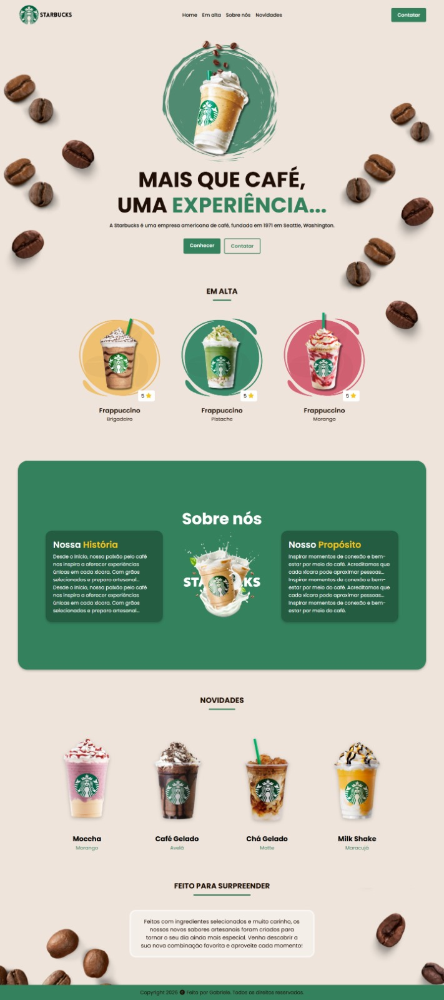

# Landing Page Starbucks ☕

Projeto de desenvolvimento de uma landing page temática inspirada na identidade visual da Starbucks, criado como parte do meu processo de aprendizagem em desenvolvimento web.

O projeto foi desenvolvido com acompanhamento de um tutorial do YouTube, permitindo aplicar na prática conceitos de estruturação de páginas, estilização e organização de elementos visuais.

## Recursos Técnicos:
HTML
CSS
JS

## Desenvolvimento:
- Estruturação semântica;
- Organização de seções;
- Estilização com CSS;
- Layout e posicionamento de elementos;
- Identidade visual e experiência do usuário.
  
## Hospedagem: 
O projeto não foi publicado em hospedagem web, pois se trata de uma reprodução desenvolvida para fins educacionais, baseada em um tutorial e inspirada na identidade visual de uma marca de terceiros.

## Objetivo: 
Desenvolver habilidades iniciais em desenvolvimento front-end e ampliar meu portfólio acadêmico e profissional.

## Prévia do Projeto:

## Referência de aprendizagem

Projeto desenvolvido com base em um tutorial disponível no YouTube, utilizado como material de apoio para praticar e aprofundar conhecimentos em desenvolvimento front-end.

🔗 https://youtu.be/ik-njdH5Q5c?is=G6kBBZ8OLgJ3JbG9
